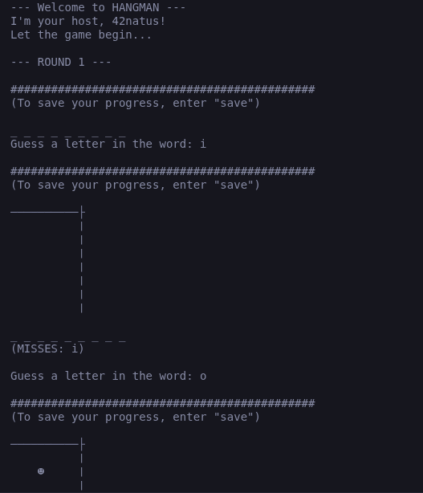
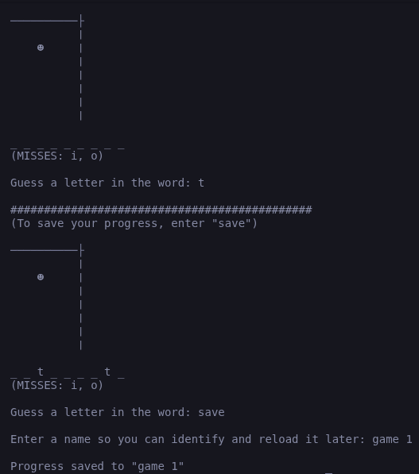
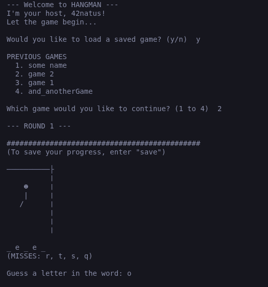

# hangman

A command line implementation of the [Hangman game](https://www.wikihow.com/Play-Hangman).

This implementation adds one cool feature though: you can save your progress in a round and reload it later when you're ready to continue. You can save multiple game rounds this way. When you're ready to resume any of your saved games, just pick it from the menu and play on!

## Game play

Make sure to give [this](https://www.wikihow.com/Play-Hangman) a read to understand the rules of the game.

## Check it out yourself

1. Make sure you've got [Ruby installed on your local machine](https://www.theodinproject.com/lessons/ruby-installing-ruby). 

2. Clone this repo.

3. Run

```ruby
bundle install
```

to install dependencies automatically.

4. Run

```ruby
bundle exec ruby main.rb
```

to play the game!

## Screenshots

Here are some screenshots of gameplay:

#### 1.



#### 2.



#### 3.


